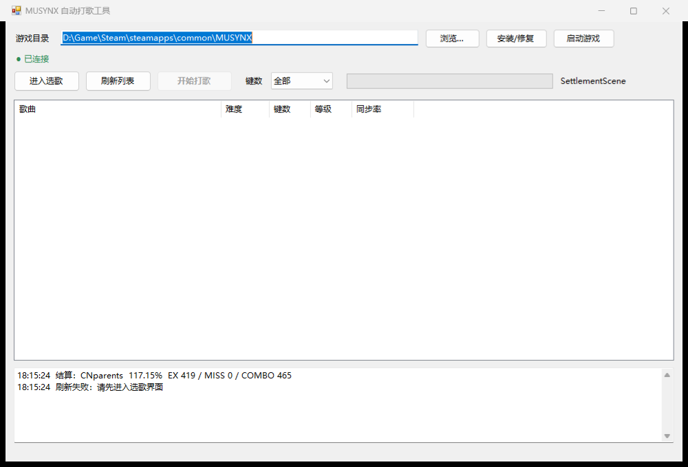

# MUSYNX 自动打歌 Mod

同步音律喵赛克（Steam 原版，Unity 2017.4.4f1）的进程内自动演奏插件。
不截图、不识别下落音符：直接读游戏内部的谱面对象和歌曲时钟，按音符时序调用游戏自己的击打入口。

## 当前状态

已在本机安装并跑通完整一首：

- 曲目：Moonlight（Hard，131 秒，867 个判定音符）
- 结果：**EX 867 / EXACT 867 / GREAT 0 / RIGHT 0 / MISS 0 / 全连**
- 全程窗口处于后台（未聚焦），没有触发暂停
- 结算正常进入，排行榜上传被拦截

## 装了什么

游戏目录 `D:\Game\Steam\steamapps\common\MUSYNX`：

| 路径 | 作用 |
| --- | --- |
| `winhttp.dll`、`doorstop_config.ini`、`.doorstop_version` | Unity Doorstop，BepInEx 5.4.23.5 的入口 |
| `BepInEx\core\*` | BepInEx 运行时 |
| `BepInEx\plugins\MusynxAutoplay\MusynxAutoplay.dll` | 自动打歌插件 |
| `BepInEx\config\local.musynx.autoplay.cfg` | 配置（首次运行生成） |
| `BepInEx\MusynxAutoplayBackup\globalgamemanagers.orig` | 启动对话框补丁的原文件备份 |

另外改了 `MUSYNX_Data\globalgamemanagers` 的 **1 个字节**（offset 4416，`1 → 0`），把 Unity 的启动分辨率对话框关掉。

## 用法

1. 从 Steam 正常启动（不再弹 "MUSYNX Configuration"）。
2. 选歌 → 开始，进入歌曲后自动打。
3. **F9** 开关自动打歌（进歌前后都可以按）。

### 配置

`BepInEx\config\local.musynx.autoplay.cfg`：

```toml
[General]
Enabled = true            # 进歌自动开
Mode = Native             # Native=走游戏输入入口 AddButton；Perfect=直接按谱面时间判定（实验）
OffsetMs = 0              # 整体提前量，正值=更早
ToggleKey = F9
BlockUpload = true        # 不上传排行榜
IgnoreFocusPause = true   # 切出窗口不暂停
Verbose = false           # 每次命中写日志

[Dev]
AutoTest = false          # 自动选歌跑一首（自测用，别开）
```


## 图形工具（MUSYNX-Tool.exe）

独立窗口的 Windows 程序，不用记命令。

**位置**：`dist\MUSYNX-Tool.exe`，必须和 `dist\payload\`、`dist\BepInEx\` 放在同一层（安装时要复制这两个目录里的文件）。



**用法**：

1. 打开工具，"游戏目录"自动带出上次路径，可用「浏览…」改。
2. 点「安装/修复」—— 把 BepInEx、插件、启动对话框补丁一次性装好（可重复执行）。
3. 点「启动游戏」，等它进到开场画面。
4. 点「进入选歌」，等场景切到选歌界面。
5. 点「刷新列表」，左侧会列出全部曲目（歌名 / 难度 / 键数 / 等级 / 已有同步率），可按 4K/6K 过滤。
6. 选一首，点「开始打歌」（或双击）。进度条走完会打印结算：同步率、EX、MISS、COMBO。

顶部绿点表示已连上游戏内的插件（127.0.0.1:38091）。打歌过程中随时可以按 F9 暂停自动演奏。

> 如果双击 `MUSYNX-Tool.exe` 弹出 Windows 的「无法验证发布者」警告，改双击同目录的 **`启动工具.cmd`**：它用 `start` 拉起 exe，走的是 CreateProcess，不经过 Shell 的发布者检查。

**说明**：

- 工具只负责"选歌 + 开歌 + 看结果"，实际判定仍在游戏进程里由插件完成。
- 全成就一条龙还没做（按你的要求先做前两项）。

## 两个顺手修掉的问题

1. **失焦暂停**：游戏在 `UI*_NoteFactory.Update` 里每帧检查 `Application.isFocused`，一旦失去焦点就调 `PlayPause()`，同时 `OnApplicationFocus/OnApplicationPause` 也会暂停。插件把这两条路径都拦掉了（`IgnoreFocusPause = true` 时）。
2. **每次启动的手动配置窗口**：那是 Unity 的 ScreenSelector，由 PlayerSettings 里的 `displayResolutionDialog = 1` 决定。改成 0 后直接进游戏。

## 原理

```
UI*_SongPlayer.noteByTrack[轨道]   List<NoteEntitySheath>   内部谱面对象
UI*_SongPlayer.knockIndex[轨道]    当前推进到的下标
UI*_SongPlayer.PlayTicks           歌曲时钟（100ns tick）
        │
        ▼  每帧（Harmony postfix 挂在每个 UI*_SongPlayer.Update 之后）
音符 InsertTime - PlayTicks <= 半帧 ?  →  UI*_SongPlayer.AddButton(轨道)
        │
        ▼
NoteEntitySheath.Knock() → UI*_NoteScript.Knock() → 判定/连击/音效/特效
```

- 判定用游戏自己的 `BMSLib.JudgeGrade`，不伪造分数。
- ±45ms 内都是 EX（准确率 105%–115%），半帧偏置后实测误差在 ±10ms 内。
- 长条只需打头判，尾判由游戏自己按时间结束。
- `AddButton` 成功后不会立刻推进 `knockIndex`，要等下一次调用；插件因此每帧先向后跳过已打音符再取下一个（这是第一版卡住的原因）。

## 卸载

```powershell
.\dist\uninstall.ps1
```

会删除插件、恢复 `globalgamemanagers`、移除 BepInEx 加载器。
也可以手动删掉上表里的文件，并用备份覆盖 `globalgamemanagers`。

## 注意

- 只适配本机这个构建（Build 25570400 / Unity 2017.4.4f1）。Steam 更新或"验证文件完整性"会把 `globalgamemanagers` 改回去，启动窗口会重新出现，重跑 `install.ps1` 即可。
- 默认**不上传排行榜**。自动打歌的成绩传上去就是作弊，别改这个开关。
- 测试那局已经写进本地存档（Moonlight Hard 的 867 EX），没有上传。
- `Mode = Perfect` 是实验项：直接以谱面时间触发判定，理论同步率 115%，但没跑过完整曲目。

## 文件

- `dist/install.ps1` / `dist/uninstall.ps1` — 安装卸载
- `dist/BepInEx/plugins/MusynxAutoplay/MusynxAutoplay.dll` — 插件
- `src/MusynxAutoplay/MusynxAutoplay.cs` — 源码
- `build.ps1` — 用 csc 直接编译（引用游戏自己的程序集）
- `docs/musynx-autoplay-research.md` — 前期调研
- `tools/ildump/` — 读 IL 的小工具（Mono.Cecil）
- `dist/backup/globalgamemanagers.orig` — 原始文件留档
